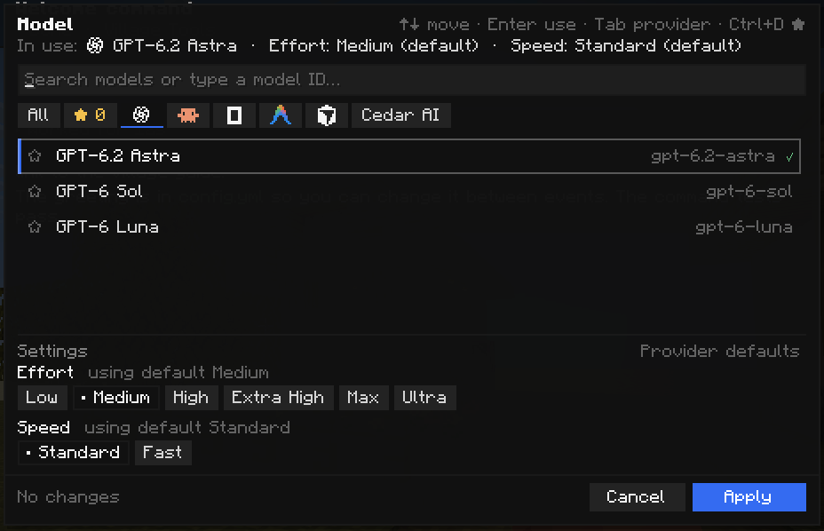

# T3 Code for Minecraft

This is an unofficial T3 Code project.

Chat with your T3 Code agents while you play Minecraft. This client-side Fabric mod connects to your T3 environment over MCP so you can browse threads, switch models, send images, and answer questions. Choose a chat message or a popup when an agent needs input, finishes, or hits an error.

## Screenshots

| Choose a model | Answer an agent question |
| --- | --- |
|  |  |

## Installation

1. Use a Minecraft Java Edition **26.3** instance with **Java 25** and [Fabric Loader](https://fabricmc.net/use/installer/) **0.19.5** or newer.
2. Download the mod JAR from the [latest GitHub release](https://github.com/karilaa-dev/t3-mc/releases/latest).
3. Put the JAR in your instance’s `mods` folder alongside [Fabric API](https://github.com/FabricMC/fabric/releases) **0.161.0** or newer for Minecraft 26.3, then launch the game.

Open **T3 Code** from the title screen or press **U** in a world. Select **Connect**, paste your T3 connection link or MCP URL, and choose **Save & connect**.
