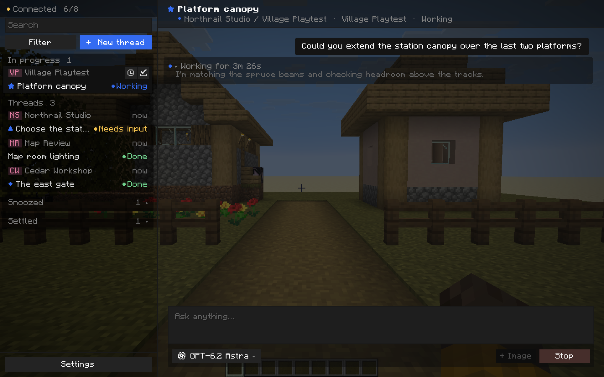
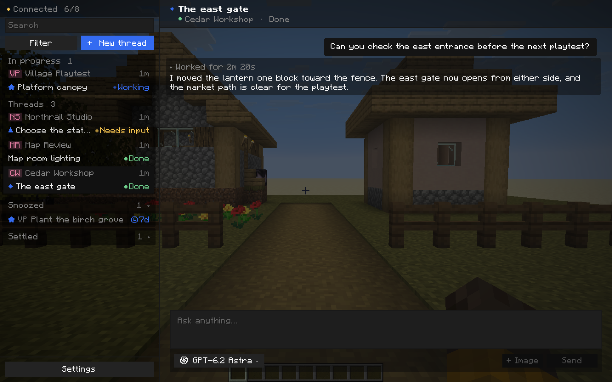
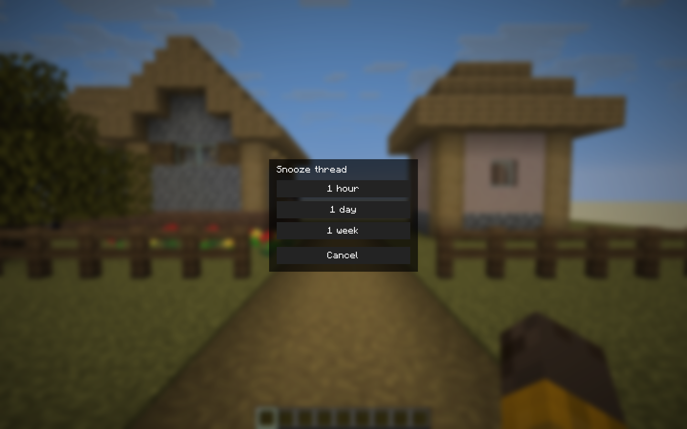
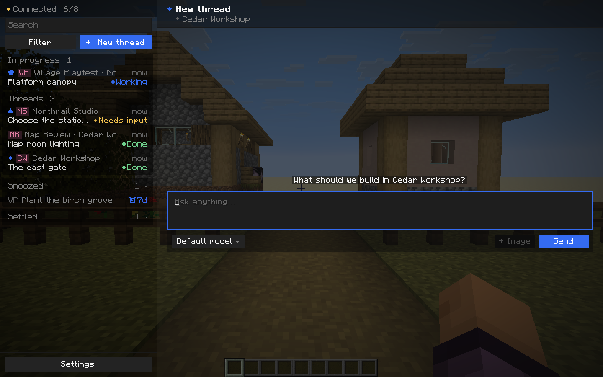
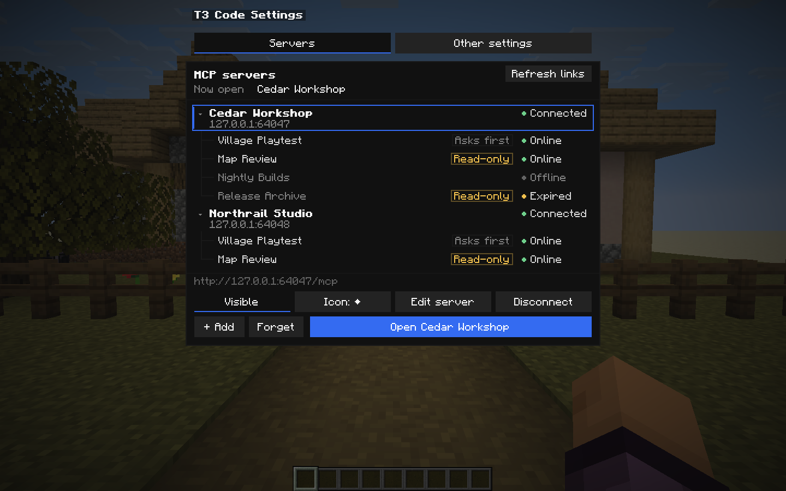
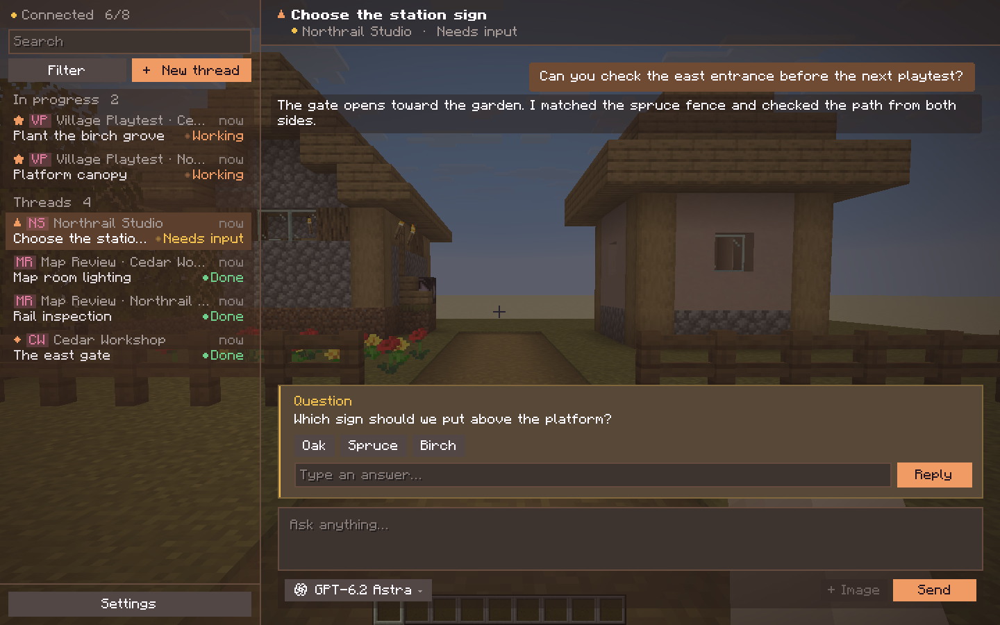
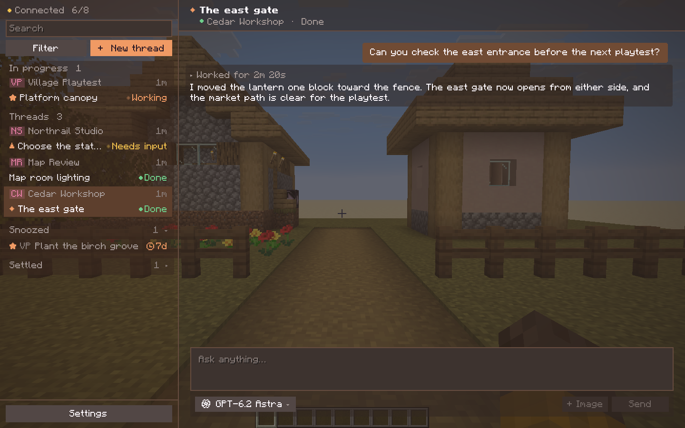

# T3 Code for Minecraft

This is an unofficial T3 Code project.

[Download t3-mc on Modrinth](https://modrinth.com/mod/t3-mc)

Chat with your T3 Code agents while you play Minecraft. This client-side Fabric mod connects to your T3 environment over MCP so you can browse threads, switch models, send images, and answer questions. Choose a chat message or a popup when an agent needs input, finishes, or hits an error.

## Screenshots

| Snoozed threads | Snooze a thread |
| --- | --- |
|  |  |

| New thread draft | Server visibility and icons |
| --- | --- |
|  |  |

| Choose a model | Answer an agent question | Custom brown theme |
| --- | --- | --- |
|  |  |  |

## Installation

1. Use a Minecraft Java Edition **26.3** instance with **Java 25** and [Fabric Loader](https://fabricmc.net/use/installer/) **0.19.5** or newer.
2. Download the mod JAR from [Modrinth](https://modrinth.com/mod/t3-mc/versions). You can also get it from [GitHub Releases](https://github.com/karilaa-dev/t3-mc/releases/latest).
3. Put the JAR in your instance’s `mods` folder alongside [Fabric API](https://github.com/FabricMC/fabric/releases) **0.161.0** or newer for Minecraft 26.3, then launch the game.

Open **T3 Code** from the title screen or press **U** in a world. Open **Settings → Servers → Add server**, paste your T3 connection link or MCP URL, and choose **Connect**.

In **Settings → Other settings → Theme**, choose a preset or click **Customize…** to edit its 12 colors with hex codes or RGB sliders. **Save as custom** keeps your palette available when you switch themes.
