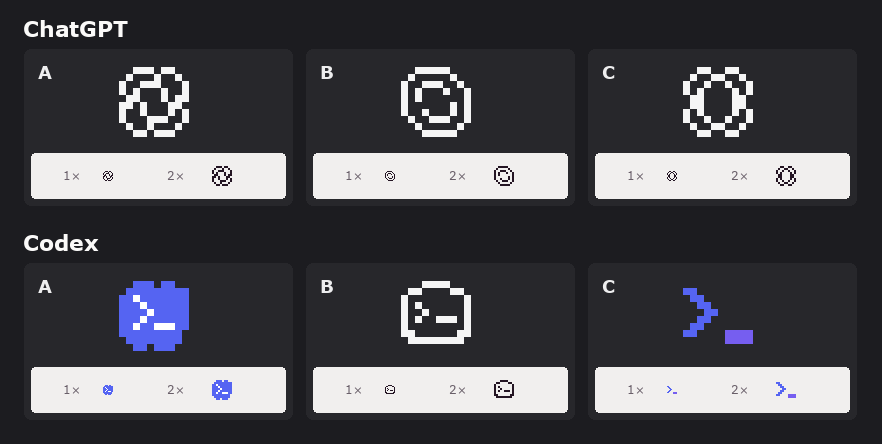

# Optional Codex icons

These six designs replace the Codex provider icon in the composer and model picker. The mod ships with Shuqi Khor’s ChatGPT icon by default.

Download `t3-mc-provider-icons.zip` from the [GitHub release](https://github.com/karilaa-dev/t3-mc/releases/tag/v0.8.4). Extract the collection, place one inner ZIP in your instance’s `resourcepacks` folder, and enable it under **Options → Resource Packs**.

Gemini 4 Neon drew the variants using the OpenAI and Codex marks from Lobe Icons as references. [Lobe Icons and MIT notice](../../src/main/resources/META-INF/licenses/t3mc/lobe-icons.txt)
